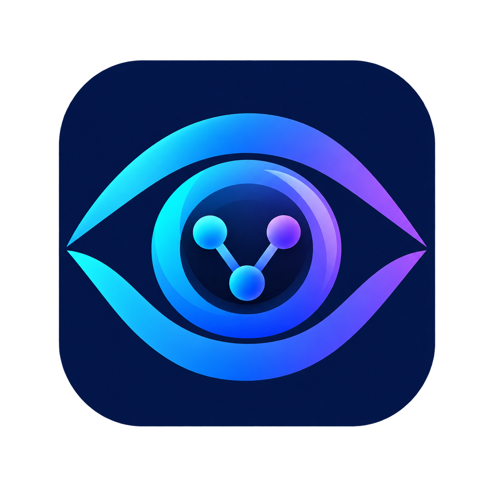
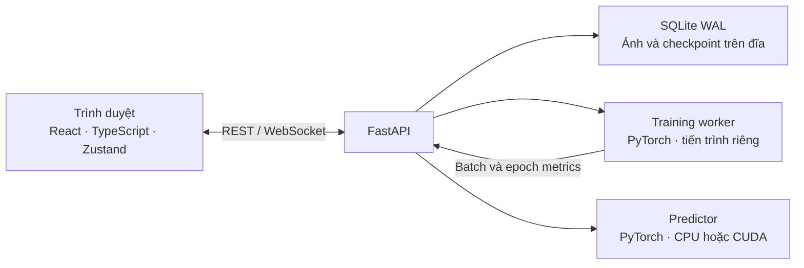

<div align="center">



# Vision Lab AI

**Phòng thí nghiệm thị giác máy tính cho lớp học.**

Tạo dữ liệu · Huấn luyện mô hình · Quan sát mạng nơ-ron · Đánh giá kết quả


[Bắt đầu nhanh](#bắt-đầu-nhanh) · [Chế độ học](#chế-độ-học) · [Kiến trúc](#kiến-trúc) · [Tài liệu](#tài-liệu)

</div>

Vision Lab AI giúp học sinh và giáo viên thực hành toàn bộ quy trình phân loại ảnh trong một giao diện: thu thập ảnh, điều chỉnh mô hình, training, kiểm tra dự đoán và so sánh thực nghiệm.

Ứng dụng chạy trên máy chủ của bạn bằng **React + FastAPI + PyTorch**, lưu ảnh và kết quả trên đĩa cục bộ. Có thể dùng CPU hoặc GPU NVIDIA với bản PyTorch hỗ trợ CUDA; không cần dịch vụ AI trả phí để training và dự đoán.

## Tính năng

- **Dataset Studio:** quản lý dự án và lớp ảnh, upload hoặc chụp webcam, chọn dataset mẫu Flower Photos hoặc Office & Fruit, chia tập train/validation và cảnh báo vấn đề chất lượng dữ liệu.
- **Training thực:** tùy chỉnh siêu tham số, bật augmentation, theo dõi batch/epoch qua WebSocket và hủy phiên đang chạy.
- **Network Playground:** sơ đồ neuron tương tác, hiệu ứng lan truyền xuôi/ngược đồng bộ với trạng thái training và các chỉ số thực.
- **Live Inference:** thử ảnh tải lên hoặc webcam với mô hình đã huấn luyện, xem xác suất theo lớp và ghi nhận phản hồi dự đoán.
- **Analytics:** đồ thị loss/accuracy, confusion matrix, mẫu dự đoán sai, so sánh thực nghiệm và nhận xét dựa trên số liệu.
- **Xuất kết quả:** checkpoint PyTorch, mô hình ONNX, metadata, nhãn và metrics CSV.

> [!NOTE]
> Loss, accuracy và tiến độ được đo từ training thực. Chuyển động, màu và trọng số trong sơ đồ neuron là minh họa, chưa phải activation hoặc gradient đo trực tiếp từ mô hình.

## Chế độ học

| Chế độ | Mô hình | Nội dung thực hành |
| --- | --- | --- |
| **Khám phá AI** — Beginner | MobileNetV3-Small học sẵn, backbone đóng băng; ảnh 224 × 224 | Chọn số epoch, cách chia dữ liệu, tỉ lệ validation và augmentation. Phần phân loại dùng cấu hình cố định. |
| **Phòng thí nghiệm** — Intermediate | MobileNetV3-Small đóng băng với đầu phân loại tùy chỉnh; ảnh 224 × 224 | Điều chỉnh learning rate, optimizer, lớp ẩn, neuron, dropout, weight decay và early stopping. |
| **Network Architect** — Advanced | CNN học từ đầu; ảnh 64 × 64 | Thiết kế 1–4 khối convolution và số filter từng khối, kết hợp các thiết lập phân loại. |

Beginner và Intermediate phù hợp để bắt đầu với ít ảnh. Advanced dành cho việc tìm hiểu kiến trúc CNN; hiệu quả phụ thuộc dữ liệu và cấu hình, không mặc định cao hơn mô hình học sẵn.

## Dataset mẫu Office & Fruit

Bộ phân loại ảnh gồm **12 lớp × 200 ảnh = 2.400 ảnh thực tế**: laptop, chuột máy tính, bàn phím, bàn làm việc, màn hình máy tính, đồng hồ đeo tay, điện thoại di động; chuối, táo, dưa hấu, cam và lê. Mười một lớp lấy từ Open Images; lớp điện thoại dùng ảnh Wikimedia Commons của các dòng smartphone ra mắt từ **2020 trở đi**, được rà soát để loại máy bàn phím đời cũ, tablet, ảnh chụp màn hình, hình dựng và linh kiện rời. Ảnh được cắt theo vật thể khi cần, chuyển RGB, thu nhỏ tối đa 512px và lọc ảnh hỏng, ảnh quá nhỏ, ảnh trùng/gần trùng. Mỗi ảnh nguồn chỉ đóng góp một ảnh cắt cho toàn bộ bộ dữ liệu; các ảnh không phải bản augmentation để tăng số lượng.

Lớp mới có tên **Smartphone (2020+)**, ID nội bộ vẫn là `phone`. Khi cập nhật source, manifest mới làm cache cũ được kiểm tra lại và tải ảnh điện thoại mới khi cần. Khởi động lại backend và tải lại trang để thấy tên mới trong thư viện. Dự án đã nhập trước đó giữ nguyên ảnh, tên lớp cũ và lịch sử: chọn **Tạo dự án mới từ dataset** để dùng bộ smartphone mới, tránh thay đổi dữ liệu gắn với mô hình đã huấn luyện. Không dùng lại gói offline cũ với manifest mới; chuẩn bị lại cache/gói offline theo source mới.

Trong **Dataset Studio → Thư viện dataset mẫu → Office & Fruit**, giữ tất cả 12 lớp hoặc chọn nhóm lớp mong muốn, chọn 20–200 ảnh/lớp rồi bấm **Nhập vào dự án hiện tại** nếu dự án còn trống, hoặc chọn tạo dự án mới. Ứng dụng không ghi đè dự án đã có ảnh hoặc lịch sử huấn luyện. Với 200 ảnh/lớp và validation 20%, có 1.920 ảnh train và 480 ảnh validation; augmentation chỉ áp dụng lên train khi huấn luyện. Đây là dữ liệu **phân loại một nhãn mỗi ảnh**, không phải mô hình dò nhiều vật thể trong một khung hình.

Ảnh chỉ tải lần đầu cho các lớp được chọn; lần sau dùng offline. Giáo viên có thể chuẩn bị toàn bộ thư viện trước giờ học:

```powershell
.\setup.bat -PrefetchOfficeFruit
# Hoặc nếu đã setup xong:
.\backend\.venv\Scripts\python.exe backend/scripts/prepare_install.py --torch cpu --prefetch-office-fruit
```

Ở lệnh thứ hai, thay `cpu` bằng build đang cài (`cu118`, `cu124`, `cu128`…) nếu dùng CUDA. Cache nằm tại `backend/data/sample_datasets/office-fruit` (hoặc trong `VISIONLAB_DATA_DIR` tương ứng). Có thể sao chép nguyên thư mục cache sang máy học sinh để không cần mạng. Gói `office-fruit-v1.zip` được tạo khi biên soạn bộ dữ liệu, gồm ảnh theo lớp, manifest, checksum và thông tin tác giả; giải nén vào cùng thư mục cache, giữ cả các file `.json` và `.ready.json`. Không cần sao chép database để dùng thư viện trên máy khác.

Manifest được lưu trong `backend/app/data/office-fruit-v1.json`; ảnh và cache lớn không đưa vào source. Nguồn từng ảnh, bounding box, SHA-256, tác giả và giấy phép được giữ trong manifest và dự án; xuất lớp ảnh cũng kèm provenance. Ảnh Open Images dùng **CC BY 2.0**, annotation Open Images **CC BY 4.0**. Ảnh smartphone Wikimedia Commons giữ giấy phép từng ảnh (**CC BY, CC BY-SA hoặc CC0**); ảnh CC BY-SA đã chỉnh sửa giữ cùng giấy phép của ảnh gốc. Xem [Open Images](https://storage.googleapis.com/openimages/web/factsfigures_v7.html), [Wikimedia Commons](https://commons.wikimedia.org/) và file `DATASET-LICENSE.txt` khi xuất dữ liệu.

Dành cho người bảo trì muốn biên soạn lại: chạy `backend/scripts/build_office_fruit.py` để lấy hai bảng annotation/metadata chính thức (~2,9 GB, lưu trong `.cache/dataset-build`), sau đó chạy lại với `--curate`. Học sinh không cần chạy bước này.

Gói offline có thêm `SPLITS.csv` (80/20, seed 42). Cách chia mặc định dựa trên ID ảnh nguồn, nên giữ nguyên khi nhập lại cùng lựa chọn ảnh; thay seed/tỉ lệ validation sẽ tạo cách chia khác. Sau khi biên soạn, có thể chạy `backend/scripts/verify_office_fruit.py` để kiểm tra checksum, số ảnh, ảnh trùng, kích thước, cách chia và giải nén/dùng lại hoàn toàn offline. `build_office_fruit.py --audit` tạo bảng ảnh để xem xét trực quan; các ảnh nguồn bị loại thủ công được ghi trong `office-fruit-exclusions.json`.

## Bắt đầu nhanh

Các lệnh dưới đây dành cho **Windows PowerShell**, chạy từ thư mục gốc của repo.

### 1. Chuẩn bị môi trường

**Cài nhanh trên máy Windows mới:** cài Git rồi clone dự án. Setup tự dùng Python 3.11/3.12 64-bit và Node.js 24.x x64 kèm npm từ 10 nếu đã có; nếu thiếu hoặc sai phiên bản, tải Python 3.12 và Node.js 24 LTS kèm npm vào `.tools` trong dự án, không thêm vào PATH/registry của hệ thống.

```powershell
git clone https://github.com/Datdevpro/AIVision-Lab.git
cd AIVision-Lab
.\setup.bat
.\run.bat
```

Mở **<http://localhost:8000>**. `setup.bat` kiểm tra cấu hình máy, tạo virtual environment, tự chọn PyTorch CUDA khi có GPU NVIDIA/driver phù hợp (CPU nếu không), cài dependency Python, chạy `npm ci`, build frontend và tải trước trọng số MobileNet. Setup thử chạy MobileNet thực tế trên GPU; nếu kiểm tra thất bại ở chế độ `auto`, báo lỗi rồi chuyển sang CPU. `run.bat` phục vụ cả giao diện lẫn API trên một cổng; giữ cửa sổ terminal mở và bấm **Ctrl+C** để dừng. Có thể chạy các file `.bat` từ Explorer hoặc từ thư mục khác; script tự tìm thư mục dự án. Các file `.bat` dùng execution-policy bypass cho lần chạy đó, không thay đổi execution policy của hệ thống.

**Vị trí cài đặt:** mọi thư viện Python, kể cả PyTorch, được cài bằng `backend/.venv/Scripts/python.exe -m pip` vào `backend/.venv/Lib/site-packages`. Setup từ chối Python hệ thống, venv dùng chung và thư mục cài đặt trỏ qua junction/symlink. Cấu hình `PIP_TARGET`, `PIP_PREFIX`, `PIP_USER`, Python user-site và cấu hình pip bên ngoài được vô hiệu hóa trong lúc chạy setup. Cache pip/npm/uv, file tải về và thư mục tạm nằm trong `.cache`; Python/Node dự phòng nằm trong `.tools`; Vite/React/TypeScript nằm trong `frontend/node_modules`; trọng số pretrained nằm trong `backend/data/torch_cache`. Nếu clone vào ổ D, các thư mục này đều ở ổ D. Các biến môi trường chỉ thay đổi trong phiên setup và được khôi phục khi kết thúc. Setup không gỡ hay nâng cấp Python/Node có sẵn trên máy.

**Kiểm tra phần cứng:** Windows 10/11 x64 trên CPU Intel/AMD, RAM tối thiểu 4 GB (khuyến nghị từ 8 GB), trống ít nhất 8 GB trên ổ chứa dự án cho CPU hoặc 16 GB cho CUDA. Đây là ngưỡng kiểm tra của installer, không bảo đảm đủ bộ nhớ cho mọi dataset/mô hình; nên chừa thêm dung lượng cho dữ liệu và checkpoint. GPU dưới 4 GB VRAM sẽ có cảnh báo giảm batch size. GPU AMD/Intel dùng CPU trong quy trình Windows này.

Các tùy chọn setup:

```powershell
# Xem cấu hình máy, runtime còn thiếu và lựa chọn CPU/CUDA; không tải/cài gì
.\setup.bat -CheckOnly

# Mặc định: tự phát hiện NVIDIA/driver, không cần chỉ định -Torch
.\setup.bat

# Bắt buộc CPU, hoặc bắt buộc một bản CUDA (lỗi GPU sẽ dừng, không tự chuyển CPU)
.\setup.bat -Torch cpu
.\setup.bat -Torch cu118
.\setup.bat -Torch cu128

# Cài/cập nhật Visual C++ Runtime x64 nếu máy mới thiếu hoặc bị lỗi DLL
.\setup.bat -InstallVCRuntime

# Nếu bản CPU vẫn lỗi nạp DLL: dùng cặp PyTorch CPU tương thích
.\setup.bat -Torch cpu -CpuCompatibility

# Chuẩn bị sẵn cả Flower Photos (~218 MiB) để dùng offline
.\setup.bat -PrefetchFlowers

# Chỉ định Python nếu máy có nhiều phiên bản
.\setup.bat -PythonPath "C:\Python312\python.exe"

# Cài thêm pytest/httpx; hoặc bỏ tải trọng số pretrained
.\setup.bat -IncludeTests
.\setup.bat -SkipWeights

# Chạy cổng khác hoặc lưu dữ liệu ở vị trí riêng
.\run.bat -Port 8001
.\run.bat -DataDir "D:\VisionLabData"
```

Tùy chọn `-Torch` nhận `auto` (mặc định), `cpu`, `cu118`, `cu124`, `cu126`, `cu128`, `cu130`. Chế độ tự động kiểm tra GPU đầu tiên: CUDA 12.8 cho compute capability từ 7.5 và driver Windows từ 571.96; CUDA 11.8 cho GPU compute từ 5.0 đến dưới 10.0 với driver từ 522.06; trường hợp khác dùng CPU. Ví dụ RTX 4060 + driver 546.12 chọn `cu118`. Đây là lựa chọn bảo thủ; setup vẫn phải thử chạy model thực tế, không chỉ dựa vào dòng “CUDA Version” của `nvidia-smi`. Có thể chỉ định `-Torch` để dùng cấu hình khác. Driver NVIDIA được giữ nguyên; nếu chưa cài driver hoặc GPU cần driver mới, cập nhật driver rồi chạy lại setup. Xem [các cặp torch/torchvision chính thức](https://pytorch.org/get-started/previous-versions/) và [driver CUDA 12.8](https://docs.nvidia.com/cuda/archive/12.8.0/cuda-toolkit-release-notes/index.html).

Setup ghim cặp phiên bản để tránh tải nhầm bản mới không còn tương thích: CPU/cu126/cu128 dùng `torch==2.8.0` + `torchvision==0.23.0`; cu118 dùng `2.7.1` + `0.22.1`; cu124 dùng `2.6.0` + `0.21.0`; cu130 dùng `2.9.1` + `0.24.1`. Dependency backend được cập nhật theo `requirements.txt`, còn frontend dùng phiên bản trong `package-lock.json`. Đóng backend trước khi chạy lại setup. Venv hỏng, sai Python hoặc chép từ máy khác được giữ lại với tên `backend/.venv.backup-<id>`, rồi tạo lại; không xóa dữ liệu dự án. Các bản backup có thể chiếm nhiều GB. `run.bat` báo lỗi khi cổng đang bận và cho phép đổi cổng bằng `-Port`. Ứng dụng mặc định dùng `VISIONLAB_DEVICE=auto`; nếu đã ép biến này thành `cpu` thì cần bỏ cấu hình ép CPU để training dùng GPU.

PyTorch trên Windows còn cần **Microsoft Visual C++ Runtime x64**. Setup kiểm tra DLL runtime trước khi cài dependency và tự tải/cài nếu thiếu hoặc quá cũ; `-InstallVCRuntime` buộc chạy lại bước cài/cập nhật. Installer được tải vào `.cache/tmp`, kiểm tra chữ ký Microsoft rồi mới chạy. **Đây là thành phần hệ thống Windows, được Microsoft cài vào thư mục hệ thống và có thể hiện UAC yêu cầu quyền quản trị; không phải thư viện Python.** Nếu installer yêu cầu restart, khởi động lại rồi chạy setup tiếp. Có thể [tải bản x64 từ Microsoft](https://learn.microsoft.com/en-us/cpp/windows/latest-supported-vc-redist/) và chọn Install/Repair thủ công. Setup không tự cài driver NVIDIA.

Python dự phòng được tải bằng bản [uv portable](https://docs.astral.sh/uv/guides/install-python/) ghim phiên bản và SHA-256, tắt đăng ký Python vào registry/PATH. Node được tải từ [kênh Node.js 24 chính thức](https://nodejs.org/dist/latest-v24.x/) và kiểm tra SHA-256 trước khi giải nén. `-CheckOnly` chỉ báo runtime còn thiếu; không tự tải hay cài runtime.

Nếu gặp `WinError 1114`, `c10.dll` hoặc lỗi DLL tương tự, cập nhật runtime trước. Nếu vẫn lỗi với bản CPU, dùng `-CpuCompatibility` để cài đúng cặp `torch==2.8.0` / `torchvision==0.23.0` từ index CPU chính thức. Đây là tùy chọn xử lý tương thích, không phải bảo đảm sửa mọi lỗi DLL. Chạy `.\backend\.venv\Scripts\python.exe backend/scripts/prepare_install.py --diagnose` để lấy phiên bản Windows, Python và package mà không cần import PyTorch. Lệnh này vẫn chạy khi `import torch` đang lỗi.

Cài đặt lần đầu cần Internet. Muốn dùng offline, chạy setup khi còn mạng, dùng thêm `-PrefetchFlowers` nếu cần dataset mẫu. Chỉ cần sao chép `backend/data` khi muốn mang theo dữ liệu/thí nghiệm từ máy cũ; nếu từng đặt `VISIONLAB_DATA_DIR`, sao chép thư mục tương ứng. Dừng app trước khi sao chép SQLite và dữ liệu. Giữ nguyên cấu trúc database, `projects`, `checkpoints`, `torch_cache` và `sample_datasets`; thư mục `.venv` và `node_modules` được tạo lại bằng setup trên máy mới.

**Lịch sử training:** mở tab **Lịch sử training** trong khu vực phân tích phía dưới Lab để xem random seed, cấu hình, các chỉ số trung bình theo lớp và ma trận nhầm lẫn của từng lần huấn luyện. Lịch sử được lưu cục bộ trong `backend/data/visionlab.sqlite3` (hoặc thư mục `VISIONLAB_DATA_DIR`), được Git bỏ qua cùng các file SQLite phụ `-wal`, `-shm` và checkpoint. Một bản clone mới sẽ có lịch sử trống; chỉ sao chép database khi chủ động muốn chuyển lịch sử sang máy khác.

**Cài thủ công hoặc chạy chế độ phát triển:**

| Thành phần | Môi trường đề xuất |
| --- | --- |
| Python | 3.11 hoặc 3.12; ví dụ bên dưới dùng 3.12 |
| Node.js | 24.x để chạy frontend và các test TypeScript trực tiếp |
| Trình duyệt | Chrome hoặc Edge phiên bản mới |
| Phần cứng | CPU để bắt đầu; GPU NVIDIA/CUDA là tùy chọn |

```powershell
git clone https://github.com/Datdevpro/AIVision-Lab.git
cd AIVision-Lab

py -3.12 -m venv backend/.venv
.\backend\.venv\Scripts\python.exe -m pip install --upgrade pip
.\backend\.venv\Scripts\python.exe -m pip install torch torchvision --index-url https://download.pytorch.org/whl/cpu
.\backend\.venv\Scripts\python.exe -m pip install -r backend/requirements.txt

npm --prefix frontend ci
```

Cấu hình trên cài PyTorch cho CPU. Nếu dùng GPU NVIDIA, chọn lệnh cài phù hợp với hệ điều hành và CUDA tại [PyTorch Start Locally](https://pytorch.org/get-started/locally/), thay cho bước cài bản CPU.

### 2. Chạy ứng dụng

**Terminal 1 — backend:**

```powershell
.\backend\.venv\Scripts\python.exe -m uvicorn app.main:app --app-dir backend --host 127.0.0.1 --port 8000 --reload --reload-dir backend/app
```

**Terminal 2 — frontend:**

```powershell
npm --prefix frontend run dev
```

| Địa chỉ | Chức năng |
| --- | --- |
| <http://localhost:5173> | Ứng dụng |
| <http://127.0.0.1:8000/docs> | Tài liệu API tương tác |
| <http://127.0.0.1:8000/api/health> | Kiểm tra backend |

Có thể dùng `start_all.bat` và `stop_all.bat` để khởi động/dừng trên Windows sau khi cài dependency. Các script này dừng tiến trình đang chiếm cổng `8000` và `5173`; dùng hai terminal ở trên nếu cần tự quản lý tiến trình.

### 3. Thực hiện thí nghiệm đầu tiên

1. Tạo dự án và ít nhất hai lớp ảnh, ví dụ “Bút” và “Điện thoại”.
2. Thêm ảnh khác góc chụp, nền và ánh sáng; giữ ảnh kiểm tra riêng với ảnh dùng để học.
3. Chọn **Khám phá AI**, bấm bắt đầu và theo dõi đồ thị hoặc sơ đồ neuron.
4. Kiểm tra bằng ảnh mới trong **Live Inference**.
5. Đổi một tham số trong **Phòng thí nghiệm**, giữ nguyên dữ liệu và cách chia tập để so sánh hai lần chạy.

Lần đầu sử dụng MobileNetV3-Small cần tải trọng số pretrained. Khi backend đã chạy, có thể tải trước bằng:

```powershell
Invoke-RestMethod -Method Post -Uri http://127.0.0.1:8000/api/system/prefetch-weights
```

Để thực hành với dữ liệu có sẵn, bấm **Chọn dataset mẫu** trong Dataset Studio, chọn 2–5 loại hoa và số ảnh mỗi lớp (20–500, tổng không quá giới hạn dự án). Nếu dự án đang chọn còn trống và chưa có lịch sử huấn luyện, bấm **Nhập vào dự án hiện tại**: tên và ID dự án được giữ nguyên, các lớp trống mặc định được thay bằng lớp của dataset. Có thể chọn **Tạo dự án mới từ dataset** nếu muốn tách riêng. Cả Flower Photos và Office & Fruit đều hỗ trợ hai cách này; không ghi đè dự án đã có ảnh hoặc kết quả huấn luyện. Ảnh mẫu vẫn có thể xóa, đổi lớp và bổ sung bằng upload/webcam. Ứng dụng lấy mẫu cân bằng theo seed, chia train/validation bằng chiến lược random và cấu hình huấn luyện hiện tại.

Để đổi tên dự án, mở danh sách dự án trên thanh công cụ, bấm biểu tượng bút chì cạnh dự án, nhập tên mới và bấm **Lưu tên**. Thao tác chỉ đổi tên, giữ nguyên ảnh, lớp, mô hình và lịch sử huấn luyện.

Lần đầu cần Internet để tải bộ Flower Photos gốc khoảng 218 MiB; backend kiểm tra SHA-256 và lưu cache tại `backend/data/sample_datasets/flowers` (hoặc bên trong `VISIONLAB_DATA_DIR`). Những lần sau dùng cache offline. Để chuẩn bị máy khác, sao chép toàn bộ thư mục cache này vào cùng vị trí trước buổi học; hoặc chép archive chính thức `flower_photos.tgz` vào thư mục đó để ứng dụng kiểm tra và giải nén khi import. MobileNet vẫn cần trọng số pretrained đã tải sẵn để huấn luyện offline. Tiến độ import chạy nền; có thể đóng hộp thoại và mở lại, nhưng không khởi động lại backend khi đang import.

Dataset gốc: [Flower Photos của TensorFlow](https://www.tensorflow.org/tutorials/load_data/images), ảnh có giấy phép CC BY 2.0. Thông tin tác giả được giữ trong mỗi dự án và tải qua **Thông tin nguồn → Bản quyền ảnh**. Năm ảnh xem trước đi kèm ứng dụng có thông tin tác giả tại `frontend/public/datasets/flowers/LICENSE.txt`.

## Kiến trúc



Frontend phụ trách giao diện và hiển thị kết quả. Training và inference hiện chạy trên backend. Worker training được tách tiến trình; khi backbone đóng băng và augmentation tắt, hệ thống có thể tính trước đặc trưng để dùng lại giữa các epoch.

Augmentation được tạo khi lấy ảnh train: lật ngang ngẫu nhiên, xoay nhẹ và thay đổi màu. Các biến thể không được lưu thành ảnh mới và không áp dụng cho validation/test.

## Bảng đánh giá mô hình

Tab **Đánh giá mô hình**, cạnh **Đánh giá & Confusion Matrix**, tự mở khi huấn luyện thành công và tải xong báo cáo. Bảng dùng cùng checkpoint tốt nhất và cùng tập validation cho bốn tiêu chí:

**Lịch sử training** hiển thị điểm trên 100 cho từng lần chạy; chọn một lần để xem tổng điểm và mở **Chi tiết điểm đánh giá**. Điểm và phiên bản công thức được lưu cùng báo cáo khi hoàn tất huấn luyện. Các lần chạy cũ chưa lưu điểm được tính từ báo cáo validation và loss checkpoint đã có; thiếu dữ liệu sẽ hiện **Chưa đủ dữ liệu**, không cần huấn luyện lại để xem điểm của lịch sử hợp lệ.

| Tiêu chí | Trọng số | Điểm đóng góp |
| --- | --- | --- |
| Overall Accuracy | 35% | `35 × accuracy` |
| F1 Macro | 20% | `20 × f1_macro` |
| Khả năng nhận diện lớp yếu nhất (Recall thấp nhất) | 20% | `20 × min(Recall từng lớp)` |
| Overall Loss | 25% | `25 × max(0, 1 − validation_loss / ln(K))` |

Các tỷ lệ dùng thang 0–1; `K` là số lớp. Loss là cross-entropy trung bình trên validation ở checkpoint tốt nhất, không phải train loss, loss thấp nhất của mọi epoch hay loss epoch cuối. `ln(K)` là loss của dự đoán gán xác suất đều cho mọi lớp: loss bằng 0 được 25 điểm, loss từ `ln(K)` trở lên được 0 điểm. Đây là quy ước chấm thực hành, không phải chuẩn chất lượng hay chỉ số hội tụ. Nếu thiếu số liệu hoặc có lớp không có ảnh validation, không hiển thị tổng điểm; không tự phân bổ lại trọng số. Validation đã dùng để chọn checkpoint, nên điểm không thay thế đánh giá trên bộ test độc lập.

## Chạy trên một cổng

Khi cập nhật các bản clone cũ, nên sao lưu `backend/data` trước khi pull nếu còn dữ liệu cần giữ: các file dự án cục bộ từng được đưa vào Git nay được gỡ khỏi phần theo dõi. Repo chỉ chứa mã nguồn, manifest và ảnh xem trước; ảnh thực hành và lịch sử SQLite lưu riêng trên từng máy.

FastAPI có thể phục vụ cả API và frontend đã build, phù hợp để chạy bản cục bộ không cần Vite dev server.

```powershell
npm --prefix frontend run build
.\backend\.venv\Scripts\python.exe -m uvicorn app.main:app --app-dir backend --host 127.0.0.1 --port 8000
```

Mở <http://localhost:8000>. Build lại frontend sau khi thay đổi mã giao diện.

> [!IMPORTANT]
> Phiên bản hiện tại xử lý **một phiên training tại một thời điểm trên mỗi backend**, chưa có hàng đợi training, tài khoản hay phân quyền dự án theo học sinh. Các phương án thực hành đồng thời trên 15 PC được mô tả trong [kế hoạch deploy](<kế hoạch deploy.md>); đó là kế hoạch phát triển, chưa phải chức năng đã triển khai.

Khi truy cập từ máy khác, webcam cần HTTPS với chứng chỉ được trình duyệt tin cậy. HTTP tại địa chỉ LAN không có ngoại lệ như `localhost`. Xem [yêu cầu truy cập webcam của trình duyệt](https://developer.mozilla.org/en-US/docs/Web/API/MediaDevices/getUserMedia).

## Cấu hình

Thiết lập biến môi trường trước khi chạy backend. Các giá trị dưới đây là mặc định trong [config.py](backend/app/core/config.py).

| Biến | Mặc định | Ý nghĩa |
| --- | --- | --- |
| `VISIONLAB_DATA_DIR` | `backend/data` | Nơi lưu database, ảnh, checkpoint và cache |
| `VISIONLAB_DEVICE` | `auto` | Thiết bị training: `auto`, `cpu` hoặc `cuda` |
| `VISIONLAB_INFERENCE_DEVICE` | `auto` | Thiết bị dự đoán: `auto` hoặc `cpu` |
| `VISIONLAB_MAX_IMAGES_PER_CLASS` | `500` | Giới hạn ảnh mỗi lớp |
| `VISIONLAB_MAX_IMAGES_PER_PROJECT` | `5000` | Giới hạn ảnh mỗi dự án |
| `VISIONLAB_MAX_CLASSES` | `12` | Giới hạn lớp mỗi dự án; đủ cho Office & Fruit 12 lớp |
| `VISIONLAB_MAX_EPOCHS` | `50` | Giới hạn số epoch |

Ví dụ chạy training và inference trên CPU:

```powershell
$env:VISIONLAB_DEVICE = "cpu"
$env:VISIONLAB_INFERENCE_DEVICE = "cpu"
```

## Kiểm thử

**Backend** — cấu hình mô hình, logic dataset, checkpoint, log lỗi và luồng API/training tích hợp:

```powershell
.\backend\.venv\Scripts\python.exe -m pip install -r backend/requirements-dev.txt
Push-Location backend
.\.venv\Scripts\python.exe -m pytest -q
Pop-Location
```

**Frontend** — logic điều khiển tham số, cấu hình CNN, luồng neuron, lỗi API và khởi tạo ứng dụng:

```powershell
node --test frontend/tests/*.test.mjs
npm --prefix frontend run build
```

Các test training tích hợp dùng dữ liệu tạm, CPU và backbone kiểm thử nhỏ, không tải trọng số pretrained.

## Xử lý sự cố

| Hiện tượng | Kiểm tra |
| --- | --- |
| Không có dự án hoặc tham số | Gọi `/api/health`, xem terminal backend và thông báo kết nối trên giao diện. Ứng dụng có timeout và tự thử tải lại dữ liệu khởi tạo. |
| Không tải được trọng số | Kiểm tra Internet và dùng endpoint `POST /api/system/prefetch-weights` trước buổi học. |
| GPU hiển thị thành CPU | Kiểm tra `torch.cuda.is_available()`, bản PyTorch đã cài và driver NVIDIA. |
| Webcam không mở | Kiểm tra quyền camera, ứng dụng khác đang dùng camera và HTTPS/localhost. |
| Cấu hình bị từ chối | Đọc mã lỗi và trường dữ liệu cụ thể trên giao diện hoặc terminal backend. Số filter phải khớp số khối convolution. |

## Cấu trúc repo

```text
Vision-Lab/
├── backend/
│   ├── app/
│   │   ├── api/          # REST API và WebSocket
│   │   ├── core/         # Cấu hình, database, đặc tả tham số, lỗi
│   │   ├── ml/           # Kiến trúc, training, preprocessing, inference
│   │   ├── models/       # Mô hình dữ liệu SQLModel
│   │   ├── services/     # Dataset, thực nghiệm và quản lý training
│   │   └── workers/      # Tiến trình training
│   └── tests/
├── frontend/
│   ├── src/
│   │   ├── components/   # Thành phần giao diện dùng chung
│   │   ├── features/     # Dataset, training, inference và analytics
│   │   ├── services/     # API client và khởi tạo
│   │   └── store/        # Trạng thái ứng dụng
│   └── tests/
├── Reference-Doc.md       # Nguyên bản README trước khi biên tập lại
├── kế hoạch deploy.md    # Hai hướng triển khai lớp học
├── start_all.bat
└── stop_all.bat
```

## Tài liệu

- [Reference Doc](Reference-Doc.md) — bản lưu nguyên nội dung README trước lần biên tập này; một số mô tả phản ánh phiên bản cũ.
- [Kế hoạch deploy](<kế hoạch deploy.md>) — so sánh training trong trình duyệt và chạy PyTorch riêng trên từng PC.
- [Đặc tả tham số](backend/app/core/param_specs.py) — phạm vi điều khiển, giá trị mặc định và giải thích trên giao diện.
- [Cấu hình mô hình](backend/app/schemas/training_config.py) — ràng buộc và preset cho ba chế độ học.

## Đóng góp

Báo lỗi hoặc đề xuất tính năng tại [GitHub Issues](https://github.com/Datdevpro/AIVision-Lab/issues). Với lỗi training, gửi bước tái hiện, chế độ, cấu hình và phần log liên quan. Khi thay đổi mã, chạy các kiểm thử tương ứng và mô tả cách kiểm tra trong pull request.
