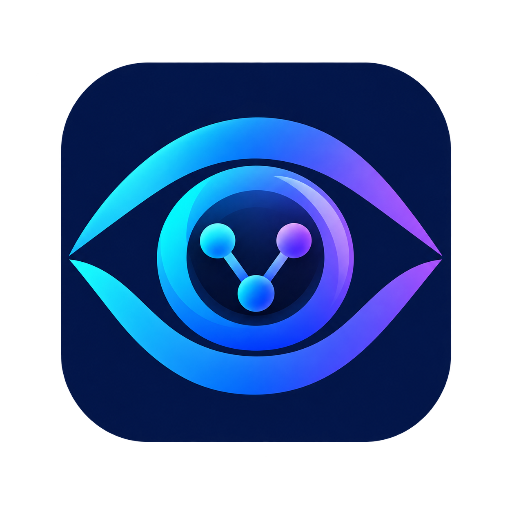
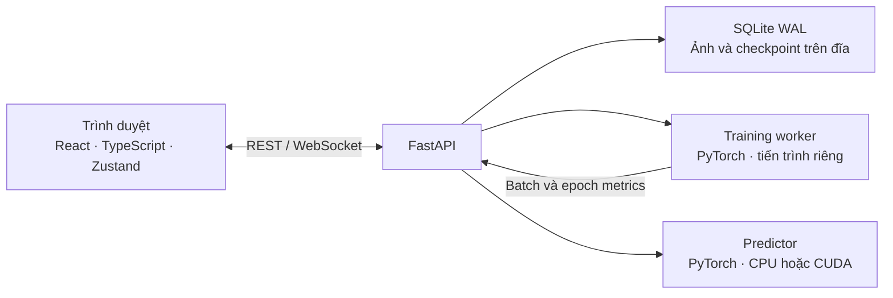

<div align="center">



# Vision Lab AI

**Phòng thí nghiệm thị giác máy tính cho lớp học.**

Tạo dữ liệu · Huấn luyện mô hình · Quan sát mạng nơ-ron · Đánh giá kết quả


[Bắt đầu nhanh](#bắt-đầu-nhanh) · [Chế độ học](#chế-độ-học) · [Kiến trúc](#kiến-trúc) · [Tài liệu](#tài-liệu)

</div>

Vision Lab AI giúp học sinh và giáo viên thực hành toàn bộ quy trình phân loại ảnh trong một giao diện: thu thập ảnh, điều chỉnh mô hình, training, kiểm tra dự đoán và so sánh thực nghiệm.

Ứng dụng chạy trên máy chủ của bạn bằng **React + FastAPI + PyTorch**, lưu ảnh và kết quả trên đĩa cục bộ. Có thể dùng CPU hoặc GPU NVIDIA với bản PyTorch hỗ trợ CUDA; không cần dịch vụ AI trả phí để training và dự đoán.

## Tính năng

- **Dataset Studio:** quản lý dự án và lớp ảnh, upload hoặc chụp webcam, chọn dataset mẫu Flower Photos, chia tập train/validation và cảnh báo vấn đề chất lượng dữ liệu.
- **Training thực:** tùy chỉnh siêu tham số, bật augmentation, theo dõi batch/epoch qua WebSocket và hủy phiên đang chạy.
- **Network Playground:** sơ đồ neuron tương tác, hiệu ứng lan truyền xuôi/ngược đồng bộ với trạng thái training và các chỉ số thực.
- **Live Inference:** thử ảnh tải lên hoặc webcam với mô hình đã huấn luyện, xem xác suất theo lớp và ghi nhận phản hồi dự đoán.
- **Analytics:** đồ thị loss/accuracy, confusion matrix, mẫu dự đoán sai, so sánh thực nghiệm và nhận xét dựa trên số liệu.
- **Xuất kết quả:** checkpoint PyTorch, mô hình ONNX, metadata, nhãn và metrics CSV.

> [!NOTE]
> Loss, accuracy và tiến độ được đo từ training thực. Chuyển động, màu và trọng số trong sơ đồ neuron là minh họa, chưa phải activation hoặc gradient đo trực tiếp từ mô hình.

## Chế độ học

| Chế độ | Mô hình | Nội dung thực hành |
| --- | --- | --- |
| **Khám phá AI** — Beginner | MobileNetV3-Small học sẵn, backbone đóng băng; ảnh 224 × 224 | Chọn số epoch, cách chia dữ liệu, tỉ lệ validation và augmentation. Phần phân loại dùng cấu hình cố định. |
| **Phòng thí nghiệm** — Intermediate | MobileNetV3-Small đóng băng với đầu phân loại tùy chỉnh; ảnh 224 × 224 | Điều chỉnh learning rate, optimizer, lớp ẩn, neuron, dropout, weight decay và early stopping. |
| **Network Architect** — Advanced | CNN học từ đầu; ảnh 64 × 64 | Thiết kế 1–4 khối convolution và số filter từng khối, kết hợp các thiết lập phân loại. |

Beginner và Intermediate phù hợp để bắt đầu với ít ảnh. Advanced dành cho việc tìm hiểu kiến trúc CNN; hiệu quả phụ thuộc dữ liệu và cấu hình, không mặc định cao hơn mô hình học sẵn.

## Bắt đầu nhanh

Các lệnh dưới đây dành cho **Windows PowerShell**, chạy từ thư mục gốc của repo.

### 1. Chuẩn bị môi trường

| Thành phần | Môi trường đề xuất |
| --- | --- |
| Python | 3.11 hoặc 3.12; ví dụ bên dưới dùng 3.12 |
| Node.js | 24.x để chạy frontend và các test TypeScript trực tiếp |
| Trình duyệt | Chrome hoặc Edge phiên bản mới |
| Phần cứng | CPU để bắt đầu; GPU NVIDIA/CUDA là tùy chọn |

```powershell
git clone https://github.com/Datdevpro/AIVision-Lab.git
cd AIVision-Lab

py -3.12 -m venv backend/.venv
.\backend\.venv\Scripts\python.exe -m pip install --upgrade pip
.\backend\.venv\Scripts\python.exe -m pip install torch torchvision --index-url https://download.pytorch.org/whl/cpu
.\backend\.venv\Scripts\python.exe -m pip install -r backend/requirements.txt

npm --prefix frontend ci
```

Cấu hình trên cài PyTorch cho CPU. Nếu dùng GPU NVIDIA, chọn lệnh cài phù hợp với hệ điều hành và CUDA tại [PyTorch Start Locally](https://pytorch.org/get-started/locally/), thay cho bước cài bản CPU.

### 2. Chạy ứng dụng

**Terminal 1 — backend:**

```powershell
.\backend\.venv\Scripts\python.exe -m uvicorn app.main:app --app-dir backend --host 127.0.0.1 --port 8000 --reload --reload-dir backend/app
```

**Terminal 2 — frontend:**

```powershell
npm --prefix frontend run dev
```

| Địa chỉ | Chức năng |
| --- | --- |
| <http://localhost:5173> | Ứng dụng |
| <http://127.0.0.1:8000/docs> | Tài liệu API tương tác |
| <http://127.0.0.1:8000/api/health> | Kiểm tra backend |

Có thể dùng `start_all.bat` và `stop_all.bat` để khởi động/dừng trên Windows sau khi cài dependency. Các script này dừng tiến trình đang chiếm cổng `8000` và `5173`; dùng hai terminal ở trên nếu cần tự quản lý tiến trình.

### 3. Thực hiện thí nghiệm đầu tiên

1. Tạo dự án và ít nhất hai lớp ảnh, ví dụ “Bút” và “Điện thoại”.
2. Thêm ảnh khác góc chụp, nền và ánh sáng; giữ ảnh kiểm tra riêng với ảnh dùng để học.
3. Chọn **Khám phá AI**, bấm bắt đầu và theo dõi đồ thị hoặc sơ đồ neuron.
4. Kiểm tra bằng ảnh mới trong **Live Inference**.
5. Đổi một tham số trong **Phòng thí nghiệm**, giữ nguyên dữ liệu và cách chia tập để so sánh hai lần chạy.

Lần đầu sử dụng MobileNetV3-Small cần tải trọng số pretrained. Khi backend đã chạy, có thể tải trước bằng:

```powershell
Invoke-RestMethod -Method Post -Uri http://127.0.0.1:8000/api/system/prefetch-weights
```

Để thực hành với dữ liệu có sẵn, bấm **Chọn dataset mẫu** trong Dataset Studio, chọn 2–5 loại hoa và số ảnh mỗi lớp (20–500, tổng không quá giới hạn dự án), rồi bấm **Tạo dự án từ dataset**. Flower Photos luôn được import vào một dự án mới; các dự án hiện có được giữ nguyên. Ảnh mẫu vẫn có thể xóa, đổi lớp và bổ sung bằng upload/webcam. Ứng dụng lấy mẫu cân bằng theo seed, chia train/validation bằng chiến lược random và cấu hình huấn luyện hiện tại.

Lần đầu cần Internet để tải bộ Flower Photos gốc khoảng 218 MiB; backend kiểm tra SHA-256 và lưu cache tại `backend/data/sample_datasets/flowers` (hoặc bên trong `VISIONLAB_DATA_DIR`). Những lần sau dùng cache offline. Để chuẩn bị máy khác, sao chép toàn bộ thư mục cache này vào cùng vị trí trước buổi học; hoặc chép archive chính thức `flower_photos.tgz` vào thư mục đó để ứng dụng kiểm tra và giải nén khi import. MobileNet vẫn cần trọng số pretrained đã tải sẵn để huấn luyện offline. Tiến độ import chạy nền; có thể đóng hộp thoại và mở lại, nhưng không khởi động lại backend khi đang import.

Dataset gốc: [Flower Photos của TensorFlow](https://www.tensorflow.org/tutorials/load_data/images), ảnh có giấy phép CC BY 2.0. Thông tin tác giả được giữ trong mỗi dự án và tải qua **Thông tin nguồn → Bản quyền ảnh**. Năm ảnh xem trước đi kèm ứng dụng có thông tin tác giả tại `frontend/public/datasets/flowers/LICENSE.txt`.

## Kiến trúc



Frontend phụ trách giao diện và hiển thị kết quả. Training và inference hiện chạy trên backend. Worker training được tách tiến trình; khi backbone đóng băng và augmentation tắt, hệ thống có thể tính trước đặc trưng để dùng lại giữa các epoch.

Augmentation được tạo khi lấy ảnh train: lật ngang ngẫu nhiên, xoay nhẹ và thay đổi màu. Các biến thể không được lưu thành ảnh mới và không áp dụng cho validation/test.

## Chạy trên một cổng

FastAPI có thể phục vụ cả API và frontend đã build, phù hợp để chạy bản cục bộ không cần Vite dev server.

```powershell
npm --prefix frontend run build
.\backend\.venv\Scripts\python.exe -m uvicorn app.main:app --app-dir backend --host 127.0.0.1 --port 8000
```

Mở <http://localhost:8000>. Build lại frontend sau khi thay đổi mã giao diện.

> [!IMPORTANT]
> Phiên bản hiện tại xử lý **một phiên training tại một thời điểm trên mỗi backend**, chưa có hàng đợi training, tài khoản hay phân quyền dự án theo học sinh. Các phương án thực hành đồng thời trên 15 PC được mô tả trong [kế hoạch deploy](<kế hoạch deploy.md>); đó là kế hoạch phát triển, chưa phải chức năng đã triển khai.

Khi truy cập từ máy khác, webcam cần HTTPS với chứng chỉ được trình duyệt tin cậy. HTTP tại địa chỉ LAN không có ngoại lệ như `localhost`. Xem [yêu cầu truy cập webcam của trình duyệt](https://developer.mozilla.org/en-US/docs/Web/API/MediaDevices/getUserMedia).

## Cấu hình

Thiết lập biến môi trường trước khi chạy backend. Các giá trị dưới đây là mặc định trong [config.py](backend/app/core/config.py).

| Biến | Mặc định | Ý nghĩa |
| --- | --- | --- |
| `VISIONLAB_DATA_DIR` | `backend/data` | Nơi lưu database, ảnh, checkpoint và cache |
| `VISIONLAB_DEVICE` | `auto` | Thiết bị training: `auto`, `cpu` hoặc `cuda` |
| `VISIONLAB_INFERENCE_DEVICE` | `auto` | Thiết bị dự đoán: `auto` hoặc `cpu` |
| `VISIONLAB_MAX_IMAGES_PER_CLASS` | `500` | Giới hạn ảnh mỗi lớp |
| `VISIONLAB_MAX_IMAGES_PER_PROJECT` | `2000` | Giới hạn ảnh mỗi dự án |
| `VISIONLAB_MAX_EPOCHS` | `50` | Giới hạn số epoch |

Ví dụ chạy training và inference trên CPU:

```powershell
$env:VISIONLAB_DEVICE = "cpu"
$env:VISIONLAB_INFERENCE_DEVICE = "cpu"
```

## Kiểm thử

**Backend** — cấu hình mô hình, logic dataset, checkpoint, log lỗi và luồng API/training tích hợp:

```powershell
.\backend\.venv\Scripts\python.exe -m pip install -r backend/requirements-dev.txt
Push-Location backend
.\.venv\Scripts\python.exe -m pytest -q
Pop-Location
```

**Frontend** — logic điều khiển tham số, cấu hình CNN, luồng neuron, lỗi API và khởi tạo ứng dụng:

```powershell
node --test frontend/tests/*.test.mjs
npm --prefix frontend run build
```

Các test training tích hợp dùng dữ liệu tạm, CPU và backbone kiểm thử nhỏ, không tải trọng số pretrained.

## Xử lý sự cố

| Hiện tượng | Kiểm tra |
| --- | --- |
| Không có dự án hoặc tham số | Gọi `/api/health`, xem terminal backend và thông báo kết nối trên giao diện. Ứng dụng có timeout và tự thử tải lại dữ liệu khởi tạo. |
| Không tải được trọng số | Kiểm tra Internet và dùng endpoint `POST /api/system/prefetch-weights` trước buổi học. |
| GPU hiển thị thành CPU | Kiểm tra `torch.cuda.is_available()`, bản PyTorch đã cài và driver NVIDIA. |
| Webcam không mở | Kiểm tra quyền camera, ứng dụng khác đang dùng camera và HTTPS/localhost. |
| Cấu hình bị từ chối | Đọc mã lỗi và trường dữ liệu cụ thể trên giao diện hoặc terminal backend. Số filter phải khớp số khối convolution. |

## Cấu trúc repo

```text
Vision-Lab/
├── backend/
│   ├── app/
│   │   ├── api/          # REST API và WebSocket
│   │   ├── core/         # Cấu hình, database, đặc tả tham số, lỗi
│   │   ├── ml/           # Kiến trúc, training, preprocessing, inference
│   │   ├── models/       # Mô hình dữ liệu SQLModel
│   │   ├── services/     # Dataset, thực nghiệm và quản lý training
│   │   └── workers/      # Tiến trình training
│   └── tests/
├── frontend/
│   ├── src/
│   │   ├── components/   # Thành phần giao diện dùng chung
│   │   ├── features/     # Dataset, training, inference và analytics
│   │   ├── services/     # API client và khởi tạo
│   │   └── store/        # Trạng thái ứng dụng
│   └── tests/
├── Reference-Doc.md       # Nguyên bản README trước khi biên tập lại
├── kế hoạch deploy.md    # Hai hướng triển khai lớp học
├── start_all.bat
└── stop_all.bat
```

## Tài liệu

- [Reference Doc](Reference-Doc.md) — bản lưu nguyên nội dung README trước lần biên tập này; một số mô tả phản ánh phiên bản cũ.
- [Kế hoạch deploy](<kế hoạch deploy.md>) — so sánh training trong trình duyệt và chạy PyTorch riêng trên từng PC.
- [Đặc tả tham số](backend/app/core/param_specs.py) — phạm vi điều khiển, giá trị mặc định và giải thích trên giao diện.
- [Cấu hình mô hình](backend/app/schemas/training_config.py) — ràng buộc và preset cho ba chế độ học.

## Đóng góp

Báo lỗi hoặc đề xuất tính năng tại [GitHub Issues](https://github.com/Datdevpro/AIVision-Lab/issues). Với lỗi training, gửi bước tái hiện, chế độ, cấu hình và phần log liên quan. Khi thay đổi mã, chạy các kiểm thử tương ứng và mô tả cách kiểm tra trong pull request.
