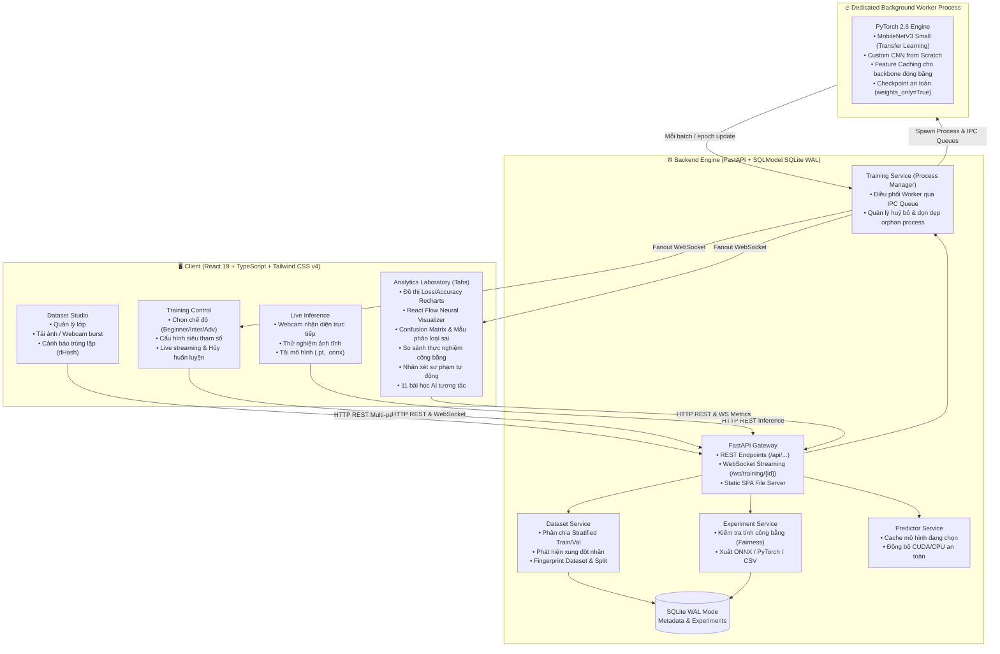

# 🔬 Vision Lab AI (Phòng Thí Nghiệm Thị Giác Máy Tính Tương Tác)

> **Hệ thống phòng thí nghiệm Trí Tuệ Nhân Tạo tương tác dành cho học sinh THPT (Lớp 10–12) và sinh viên đại học Việt Nam.**  
> Kết hợp sự trực quan, thân thiện của Google Teachable Machine với sức mạnh của một phòng nghiên cứu AI hiện đại: huấn luyện PyTorch thực tế, trực quan hóa mạng nơ-ron động, đánh giá ma trận nhầm lẫn, so sánh thực nghiệm công bằng và xuất mô hình ONNX / PyTorch.

---

## 📑 Mục Lục (Table of Contents)
1. [Tổng Quan Kiến Trúc (Architecture Overview)](#-tổng-quan-kiến-trúc-architecture-overview)
2. [Tính Năng Nổi Bật (Key Features)](#-tính-năng-nổi-bật-key-features)
3. [Yêu Cầu Hệ Thống (Prerequisites)](#-yêu-cầu-hệ-thống-prerequisites)
4. [Hướng Dẫn Cài Đặt (Installation)](#-hướng-dẫn-cài-đặt-installation)
5. [Hướng Dẫn Khởi Chạy (Running Vision Lab)](#-hướng-dẫn-khởi-chạy-running-vision-lab)
   - [Chế độ 1: Môi trường Phát triển (Development Mode)](#chế-độ-1-môi-trường-phát-triển-development-mode)
   - [Chế độ 2: Triển khai Đơn tiến trình (Production Standalone Mode)](#chế-độ-2-triển-khai-đơn-tiến-trình-production-standalone-mode)
6. [Quy Trình Kiểm Thử Tự Động (Automated Testing)](#-quy-trình-kiểm-thử-tự-động-automated-testing)
7. [Cẩm Nang Xử Lý Sự Cố (Troubleshooting Guide)](#-cẩm-nang-xử-lý-sự-cố-troubleshooting-guide)
8. [Cấu Trúc Thư Mục (Repository Structure)](#-cấu-trúc-thư-mục-repository-structure)
9. [Hướng Dẫn Sư Phạm Cho Giáo Viên (Pedagogical Guide)](#-hướng-dẫn-sư-phạm-cho-giáo-viên-pedagogical-guide)

---

## 🏛 Tổng Quan Kiến Trúc (Architecture Overview)

Vision Lab AI được thiết kế theo nguyên tắc **Local-First**, bảo vệ quyền riêng tư 100% (không gửi ảnh hay dữ liệu lên cloud), sử dụng đa tiến trình (multiprocessing) cô lập để việc huấn luyện mô hình nặng không bao giờ làm gián đoạn API hoặc giao diện người dùng.



---

## ✨ Tính Năng Nổi Bật (Key Features)

### 1. 🎓 Ba Cấp Độ Trải Nghiệm Học Tập (Learning Modes)
* **Người mới bắt đầu (Beginner):** Giao diện tối giản giống Teachable Machine. Chỉ cần cấu hình Số epochs và Tốc độ học (Learning Rate). Sử dụng Transfer Learning với MobileNetV3 Small đóng băng hoàn toàn phần trích xuất đặc trưng. Huấn luyện siêu tốc trong vài giây.
* **Trung cấp (Intermediate):** Mở khóa tinh chỉnh Classifier Head (Batch Size, Dropout, Optimizer: Adam/SGD, Weight Decay, Hàm kích hoạt: ReLU/GELU, Phân chia tập Validation). Giúp học sinh hiểu về hiện tượng Quá khớp (Overfitting) và Dưới khớp (Underfitting).
* **Nâng cao (Advanced):** Xây dựng mạng tích chập CNN từ đầu (Train from scratch). Tự thiết kế số tầng tích chập (Conv Blocks: 2 đến 4), số filters (16, 32, 64, 128), kích thước Kernel (3x3 hoặc 5x5), Data Augmentation (Lật ngang, Xoay nhẹ, Đổi màu).

### 2. ⚡ Huấn Luyện PyTorch Thực Sự (Real PyTorch, No Simulation)
* Không dùng số liệu giả lập hay thanh tiến trình định thời. Mọi giá trị Loss, Accuracy, thời gian epoch đều đo lường trực tiếp từ quá trình lan truyền xuôi (Forward pass) và lan truyền ngược (Backward pass) của PyTorch.
* Tự động nhận diện GPU NVIDIA với CUDA (ví dụ: RTX 4060, RTX 3060, GTX 1650...) và chuyển đổi mượt mà sang CPU nếu máy không có card đồ họa rời.
* Cơ chế **Feature Caching**: Khi sử dụng Transfer Learning đóng băng backbone và không dùng Augmentation, vector đặc trưng được trích xuất 1 lần duy nhất vào bộ nhớ RAM/VRAM, giúp các epoch sau chạy với tốc độ hàng trăm epoch/giây!

### 3. 📸 Thu Thập Dữ Liệu & Phân Tích Chất Lượng (Dataset Studio)
* Chụp ảnh webcam liên tục (Burst mode) với tốc độ điều chỉnh được hoặc chụp từng tấm (Single-shot).
* Tự động theo dõi Session ID khi chụp để cảnh báo hiện tượng dữ liệu tương quan cao (ảnh chụp cùng 1 góc quay dễ gây thiên kiến).
* Thuật toán băm sai phân ảnh (**dHash**) phát hiện ngay lập tức:
  - Ảnh gần như trùng lặp giữa tập Train và tập Validation (gây rò rỉ dữ liệu - Data Leakage).
  - Cùng một ảnh được gán vào 2 lớp khác nhau (Xung đột nhãn - Label Conflict).
* Tự động phân chia tập Train / Val theo phương pháp **Stratified Split** (bảo toàn tỷ lệ từng lớp) hoặc người dùng tự gán nhãn thủ công.

### 4. 🧠 Trực Quan Hóa Mạng Nơ-ron Động (React Flow Neural Visualizer)
* Sơ đồ tương tác xây dựng bằng `@xyflow/react`.
* Phân biệt rõ rệt bằng mã màu neon giữa **Các tầng đóng băng (Frozen - Non-trainable)** và **Các tầng huấn luyện (Trainable)**.
* Hiệu ứng hạt sáng mô phỏng luồng lan truyền xuôi (Forward Pass).
* Bấm vào từng khối (Input Image, Feature Extractor, Global Pooling, Dense Classifier, Softmax) để xem giải thích sư phạm chi tiết và kích thước tensor đầu ra.

### 5. 📊 Đánh Giá Toàn Diện & So Sánh Công Bằng (Evaluation & Comparison)
* **Confusion Matrix Heatmap:** Ma trận nhầm lẫn chuẩn hóa theo tỷ lệ phần trăm với chỉ số chi tiết cho từng lớp (Precision, Recall, F1-Score, Số mẫu).
* **Thư viện mẫu dự đoán sai:** Xem trực tiếp những ảnh nào bị mô hình đoán nhầm, nhãn thực tế là gì và xác suất mô hình gán sai là bao nhiêu.
* **Fair Comparison Guard:** Khi so sánh 2 thực nghiệm khác nhau, hệ thống tự động kiểm tra xem 2 mô hình có được huấn luyện trên **cùng một bộ dữ liệu và cùng cách chia Train/Val** hay không. Nếu khác nhau, huy hiệu cảnh báo màu vàng sẽ lập tức xuất hiện để nhắc nhở học sinh về nguyên tắc so sánh khoa học.
* **Nhận xét thông minh có căn cứ số liệu:** Tự động phát hiện Overfitting (Train Acc >> Val Acc), Underfitting (Val Acc thấp sau nhiều epoch), Learning Rate quá lớn hoặc dữ liệu bị mất cân bằng trầm trọng.

### 6. 📦 Xuất Mô Hình Chuẩn Công Nghiệp
* Tải về trọn gói:
  - `model.pt`: Checkpoint PyTorch lưu an toàn với `weights_only=True`.
  - `model.onnx`: Đồ thị tính toán mở chuẩn Open Neural Network Exchange, sẵn sàng chạy trong C++, trình duyệt, hoặc nhúng lên thiết bị IoT.
  - `labels.json` & `metadata.json`: Bảng nhãn và toàn bộ siêu tham số cấu hình.
  - `metrics.csv`: Bảng lịch sử mất mát và độ chính xác từng epoch cho học sinh vẽ đồ thị trong Excel / Google Sheets.

---

## 💻 Yêu Cầu Hệ Thống (Prerequisites)

| Thành phần | Yêu cầu tối thiểu | Khuyến nghị cho trải nghiệm tốt nhất |
| :--- | :--- | :--- |
| **Hệ điều hành** | Windows 10/11 (64-bit), Ubuntu 20.04+, macOS 12+ | Windows 11 64-bit |
| **Python** | Python 3.11 hoặc 3.12 | Python 3.11.x (đã kiểm thử tương thích hoàn hảo) |
| **Node.js** | Node.js 20.x hoặc mới hơn | Node.js v20.x hoặc v22.x LTS kèm npm 10+ |
| **GPU (Card đồ họa)** | Không bắt buộc (Chạy trên CPU) | NVIDIA GeForce RTX 3050 / 4060 trở lên kèm driver CUDA 12.x |
| **RAM** | 8 GB RAM | 16 GB RAM |
| **Webcam** | Tùy chọn (có thể tải ảnh từ máy tính) | Webcam 720p hoặc 1080p tích hợp / USB |

---

## 🛠 Hướng Dẫn Cài Đặt (Installation)

### Bước 1: Clone hoặc mở thư mục dự án
Mở terminal (PowerShell trên Windows hoặc Bash trên Linux/macOS) tại thư mục `Vision-Lab`:
```powershell
cd d:\datworkspace\Vision-Lab
```

### Bước 2: Cài đặt Backend (Python)
1. Tạo môi trường ảo Python trong thư mục `backend`:
   ```powershell
   cd backend
   python -m venv .venv
   ```

2. Kích hoạt môi trường ảo:
   - **Trên Windows (PowerShell):**
     ```powershell
     .\.venv\Scripts\Activate.ps1
     ```
   - **Trên Linux / macOS:**
     ```bash
     source .venv/bin/activate
     ```

3. Cài đặt các thư viện cần thiết:
   - **Nếu máy tính có GPU NVIDIA (Khuyến nghị):**
     ```powershell
     pip install torch torchvision --index-url https://download.pytorch.org/whl/cu124
     pip install -r requirements.txt
     pip install -r requirements-dev.txt
     ```
   - **Nếu máy tính chỉ dùng CPU:**
     ```powershell
     pip install torch torchvision --index-url https://download.pytorch.org/whl/cpu
     pip install -r requirements.txt
     pip install -r requirements-dev.txt
     ```

### Bước 3: Cài đặt Frontend (Node.js)
Mở một cửa sổ terminal mới và chuyển đến thư mục `frontend`:
```powershell
cd d:\datworkspace\Vision-Lab\frontend
npm install
```

---

## 🚀 Hướng Dẫn Khởi Chạy (Running Vision Lab)

Bạn có thể chạy ứng dụng theo 1 trong 2 chế độ dưới đây:

### Chế độ 1: Môi trường Phát triển (Development Mode)
*Phù hợp khi bạn muốn chỉnh sửa code giao diện hoặc backend và thấy thay đổi ngay lập tức.*

1. **Khởi chạy Backend (Terminal 1):**
   ```powershell
   cd d:\datworkspace\Vision-Lab\backend
   .\.venv\Scripts\python.exe -m uvicorn app.main:app --host 127.0.0.1 --port 8000 --reload
   ```
   *Backend sẽ chạy tại: `http://127.0.0.1:8000` (Tài liệu API Swagger tại: `http://127.0.0.1:8000/docs`).*

2. **Khởi chạy Frontend Dev Server (Terminal 2):**
   ```powershell
   cd d:\datworkspace\Vision-Lab\frontend
   npm run dev
   ```
   *Mở trình duyệt truy cập: **`http://localhost:5173`**.*

---

### Chế độ 2: Triển khai Đơn tiến trình (Production Standalone Mode)
*Chế độ lý tưởng cho phòng máy trường học: FastAPI sẽ vừa xử lý API, vừa phục vụ file tĩnh của Frontend React đã được biên dịch sẵn trên duy nhất 1 cổng (`port 8000`).*

1. **Biên dịch Frontend:**
   ```powershell
   cd d:\datworkspace\Vision-Lab\frontend
   npm run build
   ```
   *(Thao tác này sẽ tạo thư mục bundle tối ưu tại `frontend/dist`).*

2. **Khởi chạy máy chủ tích hợp:**
   ```powershell
   cd d:\datworkspace\Vision-Lab\backend
   .\.venv\Scripts\python.exe -m uvicorn app.main:app --host 0.0.0.0 --port 8000
   ```

3. **Mở trình duyệt:**
   Truy cập ngay **`http://localhost:8000`** hoặc chia sẻ địa chỉ IP mạng nội bộ (LAN) của máy chủ để các máy học sinh khác cùng truy cập!

---

## 🧪 Quy Trình Kiểm Thử Tự Động (Automated Testing)

Vision Lab AI đi kèm bộ kiểm thử tự động toàn diện với **52 bài test** bao gồm kiểm thử logic toán học, kiểm thử an toàn checkpoint, và kiểm thử tích hợp toàn bộ luồng huấn luyện thực tế (Real Worker Process).

Chạy toàn bộ test suite từ thư mục `backend`:
```powershell
cd d:\datworkspace\Vision-Lab\backend
.\.venv\Scripts\python.exe -m pytest tests -c pytest.ini -v
```

### Các nhóm kiểm thử chính:
1. `tests/test_api_integration.py`:
   - Khởi tạo tiến trình worker huấn luyện độc lập thực tế.
   - Kết nối WebSocket kiểm tra luồng phát dữ liệu metric theo từng batch và từng epoch.
   - Kiểm tra tính năng dừng huấn luyện giữa chừng (Early cancellation).
   - Kiểm thử suy luận (Inference), xuất mô hình ONNX, và tính điểm so sánh thực nghiệm.
2. `tests/test_checkpoints_insights.py`:
   - Bảo mật: Chống tấn công Directory Traversal khi đọc/ghi file checkpoint.
   - Bảo mật: Ngăn chặn thực thi mã độc qua unpickle (sử dụng cờ `weights_only=True`).
   - Kiểm thử thuật toán phân tích số liệu phát hiện Overfitting, Underfitting, và Learning Rate.
3. `tests/test_dataset_logic.py`:
   - Phân chia Stratified Train/Val tất định (Deterministic split với seed).
   - Thuật toán băm ảnh dHash và phát hiện rò rỉ dữ liệu giữa tập huấn luyện và kiểm định.
   - Phát hiện xung đột nhãn (Label conflicts).
4. `tests/test_training_config.py`:
   - Xác thực giá trị siêu tham số nằm trong ngưỡng cho phép.
   - Xác thực cấu trúc mạng tích chập Custom CNN từ đầu.
   - Kiểm tra công thức ước tính tham số học được (Trainable Parameters).

---

## 🔧 Cẩm Nang Xử Lý Sự Cố (Troubleshooting Guide)

### 1. Không nhận diện được Card đồ họa NVIDIA (CUDA Not Detected)
* **Hiện tượng:** Huy hiệu trên góc phải Header hiển thị `CPU Fallback` thay vì `RTX 4060` (hoặc tên GPU của bạn).
* **Nguyên nhân & Cách khắc phục:**
  1. Kiểm tra driver NVIDIA: Mở terminal chạy lệnh `nvidia-smi`. Nếu không có lệnh này, bạn cần cài đặt NVIDIA Driver mới nhất từ trang chủ NVIDIA.
  2. Kiểm tra phiên bản PyTorch đã cài: Chạy lệnh:
     ```powershell
     .\.venv\Scripts\python.exe -c "import torch; print('CUDA available:', torch.cuda.is_available(), 'Device:', torch.cuda.get_device_name(0) if torch.cuda.is_available() else 'None')"
     ```
  3. Nếu kết quả ra `False`, bạn đã vô tình cài phiên bản PyTorch CPU. Hãy cài lại bản CUDA:
     ```powershell
     pip install --force-reinstall torch torchvision --index-url https://download.pytorch.org/whl/cu124
     ```

### 2. Không tải được Trọng số Tiền Huấn Luyện (Pretrained Weights Download Error)
* **Hiện tượng:** Khi bắt đầu huấn luyện chế độ Beginner hoặc Intermediate lần đầu tiên, hệ thống báo lỗi không tải được trọng số `mobilenet_v3_small` từ PyTorch Hub (thường do mạng trường học chặn hoặc rớt mạng).
* **Cách khắc phục:**
  - Hệ thống cung cấp sẵn một endpoint chuyên dụng để tải trước trọng số:
    Gửi request GET đến: `http://localhost:8000/api/system/prefetch-weights`
  - Hoặc chạy script dòng lệnh kiểm tra:
    ```powershell
    .\.venv\Scripts\python.exe -c "import torchvision.models as models; models.mobilenet_v3_small(weights=models.MobileNet_V3_Small_Weights.DEFAULT); print('Tải thành công!')"
    ```
  - Trong trường hợp hoàn toàn không có internet, học sinh có thể chuyển sang chế độ **Nâng cao (Advanced Mode)** để huấn luyện mạng Custom CNN từ đầu mà không cần bất kỳ file trọng số tải ngoài nào!

### 3. Trình duyệt chặn quyền truy cập Webcam (Webcam Permission Denied)
* **Hiện tượng:** Cửa sổ chụp ảnh webcam hiển thị màn hình đen hoặc thông báo "Không thể truy cập camera".
* **Cách khắc phục:**
  1. Trình duyệt bảo mật hiện đại chỉ cho phép truy cập webcam qua giao thức an toàn `https://` hoặc địa chỉ cục bộ `http://localhost` / `http://127.0.0.1`.
  2. Bấm vào biểu tượng ổ khóa hoặc cài đặt trang web bên cạnh thanh địa chỉ trình duyệt (Chrome/Edge/Firefox) -> Chọn **Quyền riêng tư (Permissions)** -> Bật **Camera** thành **Cho phép (Allow)**.
  3. Đảm bảo không có ứng dụng nào khác (Zoom, Teams, OBS...) đang chiếm dụng độc quyền webcam.

### 4. Xung đột cổng mạng (Port 8000 hoặc Port 5173 đã được sử dụng)
* **Hiện tượng:** Lỗi `[Errno 10048] error while attempting to bind on address ('127.0.0.1', 8000)`.
* **Cách khắc phục:**
  - Tìm tiến trình đang chiếm cổng 8000 trên Windows:
    ```powershell
    netstat -ano | findstr :8000
    ```
  - Hoặc đổi sang cổng khác khi khởi động backend:
    ```powershell
    .\.venv\Scripts\python.exe -m uvicorn app.main:app --host 127.0.0.1 --port 8001
    ```
    *(Nếu đổi cổng backend, hãy sửa mục proxy trong file `frontend/vite.config.ts` trỏ tới `http://127.0.0.1:8001`).*

### 5. Kết nối WebSocket bị ngắt giữa chừng
* Giao diện Vision Lab AI được tích hợp sẵn cơ chế **Tự động kết nối lại (Auto Reconnect)** với thuật toán Exponential Backoff.
* Nếu tải lại trang (F5) trong lúc tiến trình đang huấn luyện, giao diện sẽ tự động tái kết nối tới Job ID đang chạy và tiếp tục nhận stream metric mà không làm mất trạng thái của mô hình.

---

## 📂 Cấu Trúc Thư Mục (Repository Structure)

```text
Vision-Lab/
├── README.md                           # Tài liệu hướng dẫn toàn diện của dự án
├── .gitignore                          # Cấu hình bỏ qua file nhị phân & bộ nhớ đệm
│
├── backend/                            # Máy chủ Python & Động cơ Machine Learning
│   ├── app/
│   │   ├── main.py                     # Khởi tạo FastAPI, CORS, WebSocket, Static files
│   │   ├── core/                       # Cấu hình trung tâm, CSDL & Đặc tả tham số
│   │   │   ├── config.py               # Biến môi trường, đường dẫn lưu trữ, giới hạn
│   │   │   ├── db.py                   # Kết nối SQLite với chế độ WAL chống khóa
│   │   │   ├── db_models.py            # Mô hình thực thể: Project, Class, Image, Job, Exp
│   │   │   ├── errors.py               # Xử lý lỗi có cấu trúc chuẩn hóa cho học sinh
│   │   │   └── param_specs.py          # Đặc tả tham số duy nhất (min, max, step, tooltip)
│   │   ├── ml/                         # Động cơ học máy PyTorch
│   │   │   ├── architectures.py        # MobileNetV3 Small & Custom CNN từ đầu
│   │   │   ├── preprocessing.py        # Chuẩn hóa ImageNet, Data Augmentation
│   │   │   ├── checkpoints.py          # Lưu/Tải an toàn với weights_only=True
│   │   │   ├── trainer.py              # Vòng lặp huấn luyện, Feature Caching, Streamer
│   │   │   ├── predictor.py            # Dự đoán suy luận thời gian thực đồng bộ GPU/CPU
│   │   │   └── evaluator.py            # Tính toán ma trận nhầm lẫn & phân loại sai
│   │   ├── workers/
│   │   │   └── training_worker.py      # Tiến trình độc lập (Process) huấn luyện mô hình
│   │   ├── services/                   # Logic nghiệp vụ
│   │   │   ├── dataset_logic.py        # Stratified Split, dHash, phát hiện xung đột
│   │   │   ├── dataset_service.py      # Thao tác CSDL dữ liệu ảnh và lớp
│   │   │   ├── image_ingest.py         # Kiểm tra ảnh hợp lệ, chống decompression bomb
│   │   │   ├── training_service.py     # Quản lý tiến trình huấn luyện, IPC, WebSocket
│   │   │   ├── experiment_service.py   # Lưu lịch sử, kiểm tra Fairness, xuất ONNX
│   │   │   └── insights_service.py     # Phân tích sư phạm tất định dựa trên số liệu thực
│   │   └── api/                        # Tuyến đường API REST & WebSocket
│   │       ├── dataset.py              # Quản lý lớp, tải ảnh, phân tích chất lượng
│   │       ├── training.py             # Bắt đầu, hủy, theo dõi trạng thái, WebSocket
│   │       ├── inference.py            # Nhận diện ảnh đơn và stream webcam
│   │       ├── experiments.py          # Lịch sử, so sánh công bằng, tải mô hình
│   │       ├── system.py               # Kiểm tra phần cứng (GPU/CPU), prefetch weights
│   │       └── deps.py                 # Dependency Injection cho FastAPI
│   ├── tests/                          # 52 bài kiểm thử tự động toàn diện
│   │   ├── test_training_config.py     # Kiểm thử phạm vi tham số và cấu hình mạng
│   │   ├── test_dataset_logic.py       # Kiểm thử thuật toán chia tập & dHash
│   │   ├── test_checkpoints_insights.py# Kiểm thử bảo mật checkpoint & nhận xét AI
│   │   └── test_api_integration.py     # Kiểm thử tích hợp toàn diện từ A-Z
│   ├── pytest.ini                      # Cấu hình test runner
│   ├── requirements.txt                # Thư viện runtime chính
│   └── requirements-dev.txt            # Thư viện phục vụ kiểm thử
│
└── frontend/                           # Giao diện người dùng Web tương tác
    ├── src/
    │   ├── App.tsx                     # Bố cục 3 cột màn hình nghiên cứu + thanh phân tích
    │   ├── store/
    │   │   └── useLabStore.ts          # Zustand Store quản lý toàn bộ trạng thái Lab
    │   ├── services/
    │   │   └── api.ts                  # Axios client và WebSocket manager
    │   ├── data/
    │   │   └── lessons.ts              # 11 bài học lý thuyết tương tác song ngữ Việt - Anh
    │   ├── components/
    │   │   ├── common/                 # Header, Onboarding Modal, Lesson Modal
    │   │   ├── dataset/                # Dataset Studio, Thẻ lớp học, Webcam Modal
    │   │   ├── training/               # Bảng điều khiển siêu tham số, Trạng thái huấn luyện
    │   │   ├── inference/              # Nhận diện Webcam trực tiếp, Thử nghiệm, Xuất file
    │   │   └── analytics/              # Đồ thị Recharts, React Flow Visualizer, Confusion Matrix
    │   └── types/
    │       └── api.ts                  # TypeScript definitions khớp 100% với Backend
    ├── package.json                    # Cấu hình dependencies
    └── vite.config.ts                  # Cấu hình Vite & API Proxy
```

---

## 👩‍🏫 Hướng Dẫn Sư Phạm Cho Giáo Viên (Pedagogical Guide)

Vision Lab AI được xây dựng theo phương pháp **Học tập qua khám phá (Inquiry-Based Learning)**. Dưới đây là lộ trình 4 bước gợi ý cho một tiết học 90 phút:

### Tiết Học Mẫu: "Từ Dữ Liệu Đến Quyết Định Của AI"

1. **Khởi động (15 phút) — Bài toán phân loại & Thu thập dữ liệu:**
   - Giáo viên hướng dẫn học sinh tạo 2 lớp đồ vật đơn giản ngay tại bàn học (ví dụ: *Cây bút* vs *Điện thoại*).
   - Học sinh dùng Webcam burst mode chụp từ 20–30 ảnh mỗi lớp với nhiều góc xoay khác nhau.
   - Quan sát mục **Cảnh báo chất lượng dữ liệu (Data Quality Warnings)**: Thảo luận về việc tại sao nền phòng học giống nhau có thể khiến AI học nhầm đặc trưng nền thay vì đồ vật.

2. **Khám phá 1 (20 phút) — Huấn luyện siêu tốc với Transfer Learning (Chế độ Beginner):**
   - Học sinh để nguyên tham số mặc định (10 Epochs, Learning Rate = 0.001) và bấm **Bắt đầu huấn luyện**.
   - Quan sát đường cong hàm mất mát (Loss) đi xuống và độ chính xác (Accuracy) tăng lên theo từng batch thông qua WebSocket.
   - Thử nghiệm ngay ở bảng **Live Inference** với đồ vật thực tế trước camera.

3. **Khám phá 2 (25 phút) — Thí nghiệm so sánh siêu tham số (Chế độ Intermediate):**
   - Học sinh tạo một thực nghiệm thứ hai: Tăng Learning Rate lên thật cao (`0.1`) hoặc giảm xuống thật thấp (`0.00001`).
   - Mở tab **So sánh thực nghiệm (Experiment Comparison)** để đặt hai lần chạy cạnh nhau.
   - Đọc phần **Phân tích sư phạm thông minh (Smart Insights)** để hiểu tại sao đồ thị Loss lại dao động dữ dội hoặc không chịu giảm.
   - Quan sát **Huy hiệu công bằng (Fairness Badge)** để hiểu tầm quan trọng của việc giữ nguyên tập dữ liệu khi so sánh hai thuật toán.

4. **Nâng cao & Tổng kết (30 phút) — Mở hộp đen nơ-ron (Chế độ Advanced & React Flow):**
   - Mở tab **Sơ đồ mạng nơ-ron (Neural Visualizer)** để xem kích thước dữ liệu biến đổi như thế nào khi đi từ bức ảnh 224x224 qua các bộ lọc tích chập (Convolutional Filters) đến tầng phân loại Softmax.
   - Học sinh tải file mô hình `.onnx` và bảng `.csv` kết quả về để hoàn thành bài thu hoạch.

---

**Phát triển với ❤️ phục vụ giáo dục Trí Tuệ Nhân Tạo thế hệ trẻ Việt Nam.**  
*Bản quyền phần mềm thuộc về Vision Lab AI Project.*
